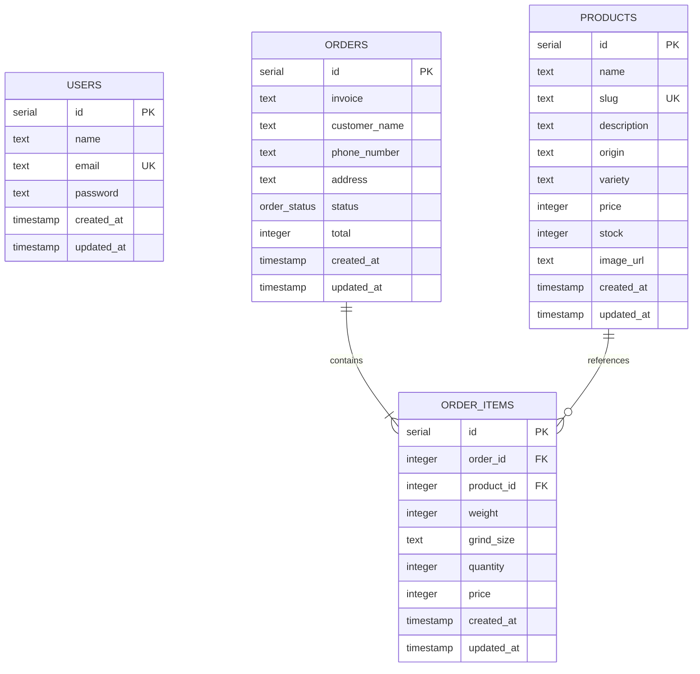

# ERD — Amarta Kopi

Diagram menggambarkan tabel dan relasi berdasarkan skema Drizzle saat ini.

## Catatan

- `users` menyimpan akun admin. Pembeli tidak memiliki akun dan tidak berelasi dengan `orders`.
- `products.price` adalah harga dasar per kilogram dalam integer rupiah.
- `order_items.price` adalah harga per kemasan saat pesanan dibuat; `weight` dan `grind_size` menyimpan pilihan varian pada transaksi.
- Penghapusan pesanan menghapus item-itemnya melalui relasi cascade. Produk yang sudah dirujuk item pesanan tidak dihapus otomatis.
- Status pesanan berasal dari enum `order_status`: `pending`, `processing`, `shipped`, `completed`, dan `cancelled`.
- `invoice` saat ini wajib diisi, tetapi skema tidak menetapkan constraint unique.
