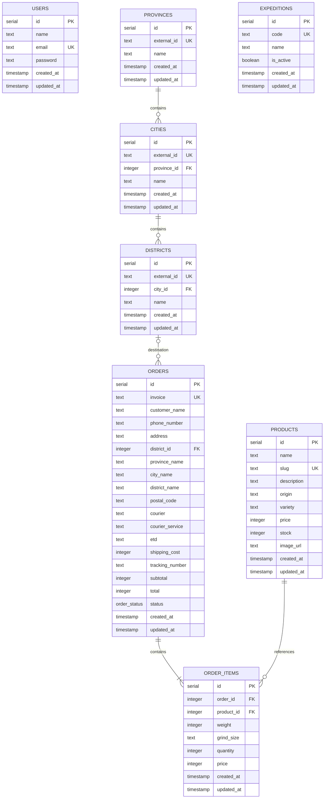

# ERD — Amarta Kopi

Diagram menggambarkan tabel dan relasi berdasarkan skema Drizzle saat ini.

## Catatan

- `users` menyimpan akun admin. Pembeli tidak memiliki akun dan tidak berelasi dengan `orders`.
- `products.price` adalah harga dasar per kilogram dalam integer rupiah.
- `order_items.price` adalah harga per kemasan saat pesanan dibuat; `weight` dan `grind_size` menyimpan pilihan varian pada transaksi.
- Penghapusan pesanan menghapus item-itemnya melalui relasi cascade. Produk yang sudah dirujuk item pesanan tidak dihapus otomatis.
- Status pesanan berasal dari enum `order_status`: `pending`, `processing`, `shipped`, `completed`, dan `cancelled`.
- `orders.subtotal` adalah jumlah harga barang; `shipping_cost` adalah ongkos kirim; `total` adalah subtotal ditambah ongkos kirim.
- `orders.district_id` mengacu pada kecamatan di cache lokasi; nama provinsi/kota/kecamatan pada pesanan disimpan sebagai snapshot agar alamat transaksi tetap terbaca.
- `orders.courier` dan `courier_service` menyimpan pilihan layanan; `tracking_number` dapat diisi setelah pesanan dikirim. Daftar kurir aktif berasal dari `expeditions`.
- `invoice` wajib diisi dan memiliki constraint unique.
- Cache penawaran ongkir bertanda tangan dan kedaluwarsa disimpan di token checkout, bukan di tabel database.
